# Illustrated Playbook — 26 normative examples

Each design reference illustrates the **component grammar** and is not a real research source. Replace all labels/data with the subject's verified material. Each example includes a **selection trigger**, **PASS** and **FAIL**; the agent MUST inspect the relevant picture before placing that component. Use `references/visual-explanation-system.md` as the authoritative routing algorithm.

**Example picture convention:** asset SVG is the editable vector source and PNG is its rendered reference image. Native Word field implementations are specified in `references/advanced-word-features.md`; visual examples alone do not prove actual Word refresh behavior. Any figures showing sample numbers/years are fictional schematic layouts.

## 01-cover: Cover + Introduction

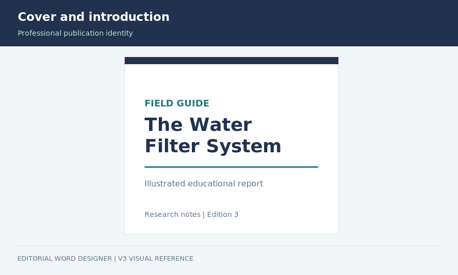

- **Use when:** substantive report, guide or course.
- **PASS:** Exact title from brief; organization/logo only with permission; readable cover; first-page header hidden.
- **FAIL:** Invented institutional logo or cluttered text.
- **Vector source:** [`01-cover.svg`](../assets/visual-examples/01-cover.svg)

## 02-toc: True Word Toc

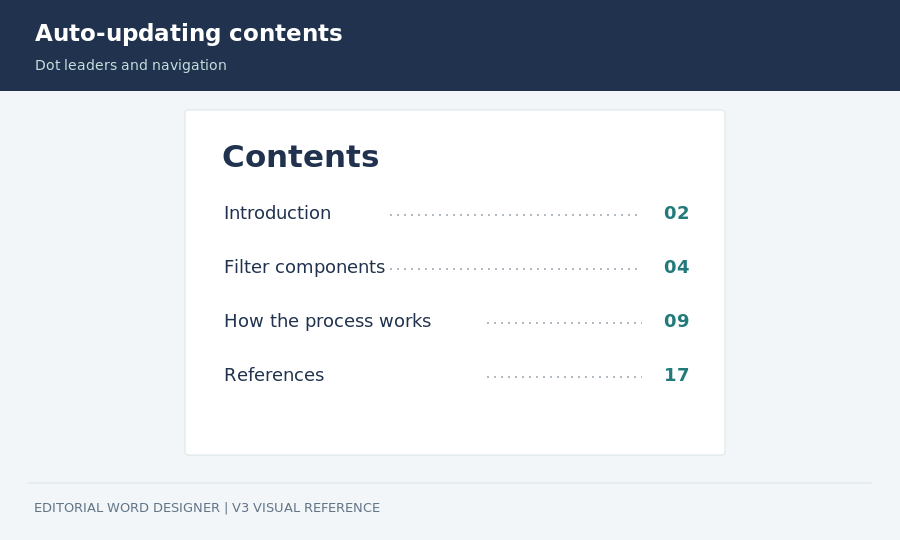

- **Use when:** longform has multiple sections.
- **PASS:** Heading styles + actual TOC field + dotted page leaders after supported refresh.
- **FAIL:** Hardcoded page numbers presented as dynamic.
- **Vector source:** [`02-toc.svg`](../assets/visual-examples/02-toc.svg)

## 03-header-footer: Running Section Header, Footer And Page

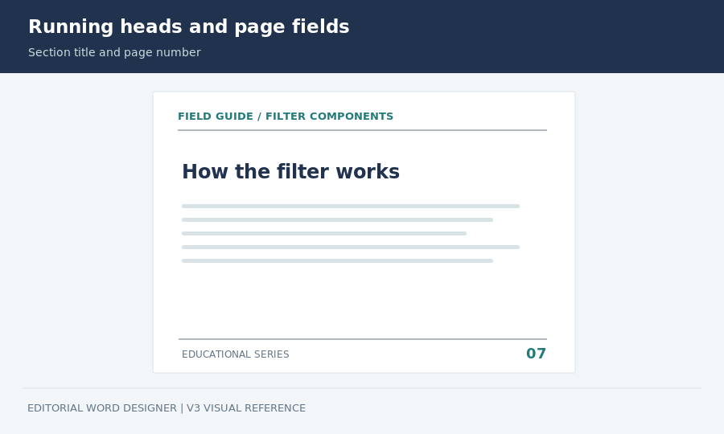

- **Use when:** more than one substantive page.
- **PASS:** STYLEREF or section fallback; PAGE field; clean first page.
- **FAIL:** Manually typed page number.
- **Vector source:** [`03-header-footer.svg`](../assets/visual-examples/03-header-footer.svg)

## 04-icon-rule: Semantic Icon

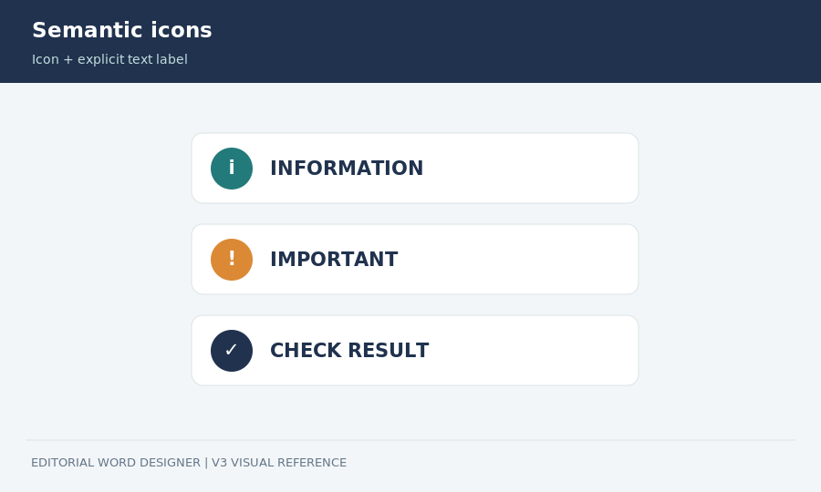

- **Use when:** one short scan cue.
- **PASS:** Single-family icon + readable adjacent label.
- **FAIL:** Icon without explanatory words.
- **Vector source:** [`04-icon-rule.svg`](../assets/visual-examples/04-icon-rule.svg)

## 05-annotated-image: Annotated Authentic Instructional Image

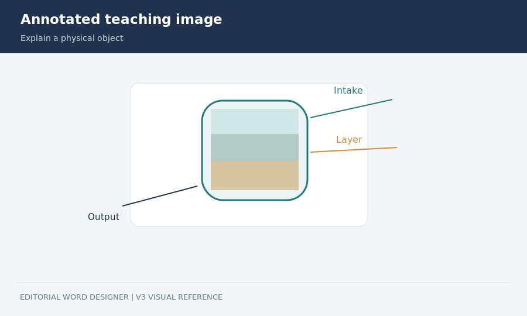

- **Use when:** real-world appearance necessary.
- **PASS:** Rights verified, key parts labelled, alt text, explanatory caption.
- **FAIL:** Unsourced stock photo or fabricated evidence.
- **Vector source:** [`05-annotated-image.svg`](../assets/visual-examples/05-annotated-image.svg)

## 06-illustration: Labeled Schematic Drawing

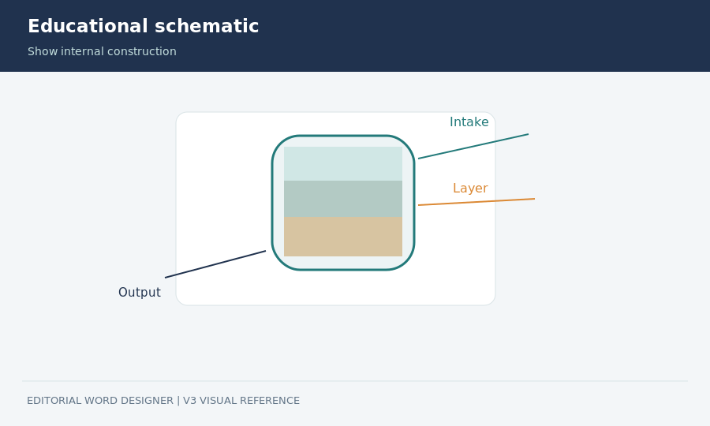

- **Use when:** internal structure cannot be shown clearly by text alone.
- **PASS:** Clean vector diagram explicitly labelled schematic.
- **FAIL:** Unlabelled eye candy.
- **Vector source:** [`06-illustration.svg`](../assets/visual-examples/06-illustration.svg)

## 07-process-flow: Sequential Process

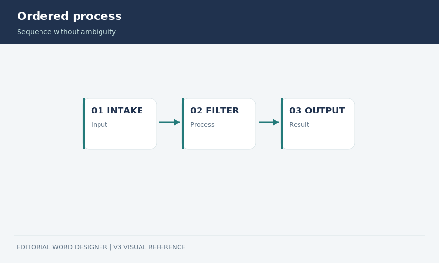

- **Use when:** ordered actions.
- **PASS:** Arrows flow from start through steps to result; names on each step.
- **FAIL:** Mind map falsely representing a process.
- **Vector source:** [`07-process-flow.svg`](../assets/visual-examples/07-process-flow.svg)

## 08-decision: Conditional Decision Tree

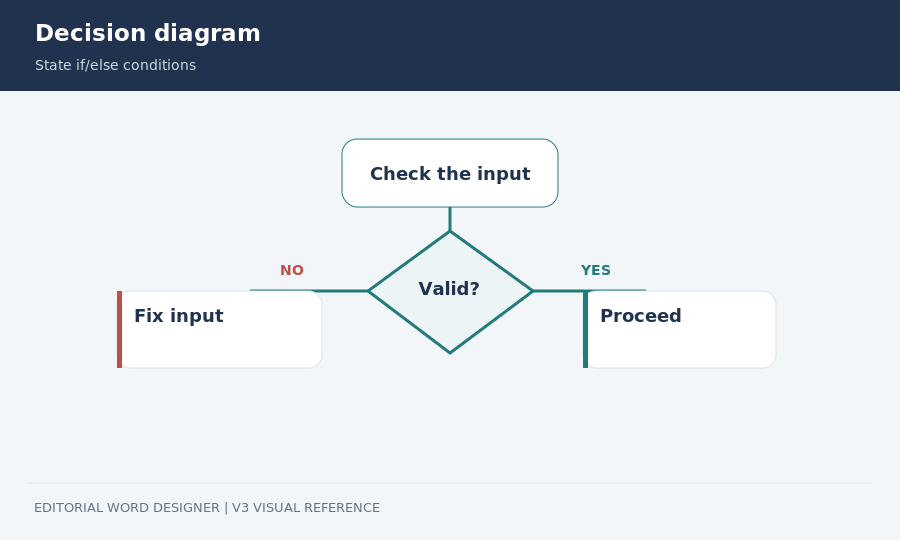

- **Use when:** choice controls next step.
- **PASS:** Every branch says YES/NO or exact condition.
- **FAIL:** Unlabelled branches or made-up rules.
- **Vector source:** [`08-decision.svg`](../assets/visual-examples/08-decision.svg)

## 09-mindmap: Concept/Mind Map

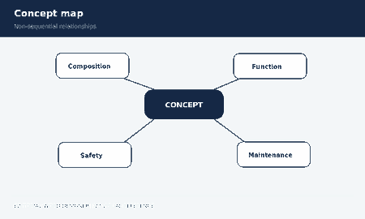

- **Use when:** relationships are nonsequential.
- **PASS:** Central concept, grouped subtopics and real relationship labels.
- **FAIL:** Arrows implying unsupported chronology.
- **Vector source:** [`09-mindmap.svg`](../assets/visual-examples/09-mindmap.svg)

## 10-comparison: Side-By-Side Comparison Table

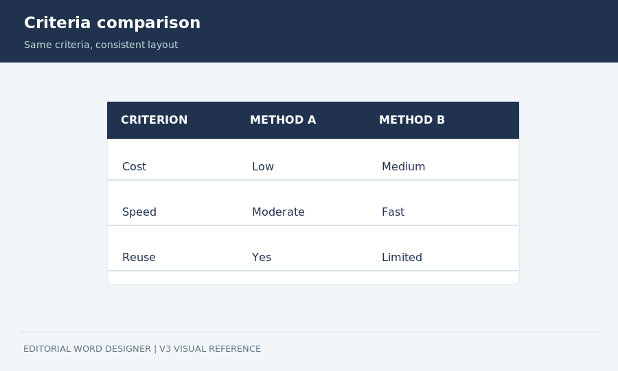

- **Use when:** same criteria across items.
- **PASS:** Equal metrics and units; missing entries clearly identified.
- **FAIL:** Rating scales invented to fill blanks.
- **Vector source:** [`10-comparison.svg`](../assets/visual-examples/10-comparison.svg)

## 11-data-chart: Sourced Quantitative Chart

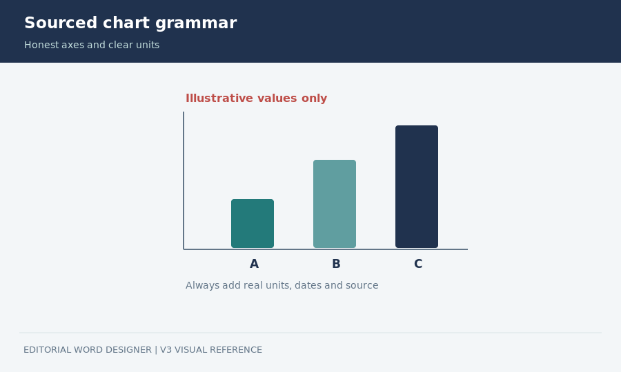

- **Use when:** observed real measurements and provenance.
- **PASS:** Axes, units, honest scale, dated cited dataset and accessible table.
- **FAIL:** Synthetic data in a factual report.
- **Vector source:** [`11-data-chart.svg`](../assets/visual-examples/11-data-chart.svg)

## 12-timeline: Dated Timeline

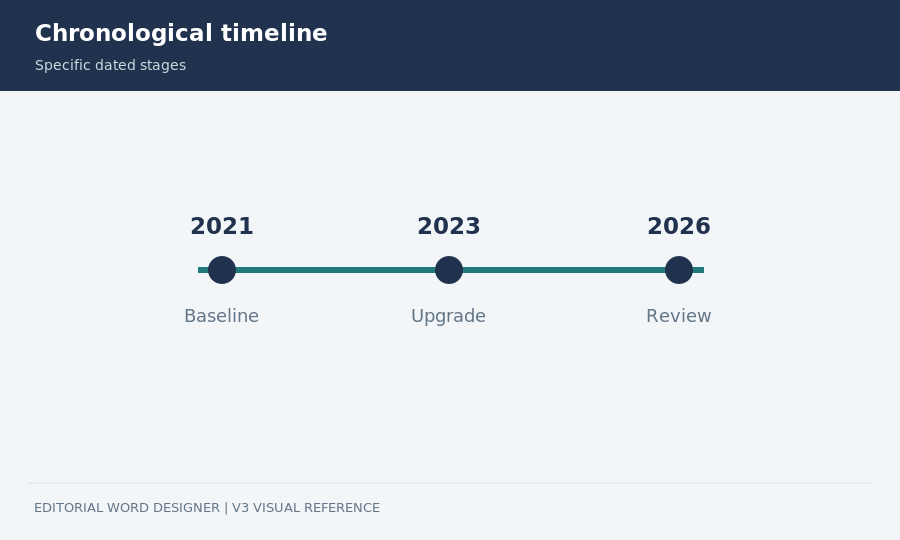

- **Use when:** real chronological milestones.
- **PASS:** Ordered dates, event labels, cited factual dates.
- **FAIL:** Made-up or mixed date order.
- **Vector source:** [`12-timeline.svg`](../assets/visual-examples/12-timeline.svg)

## 13-map: Data-Verified Map

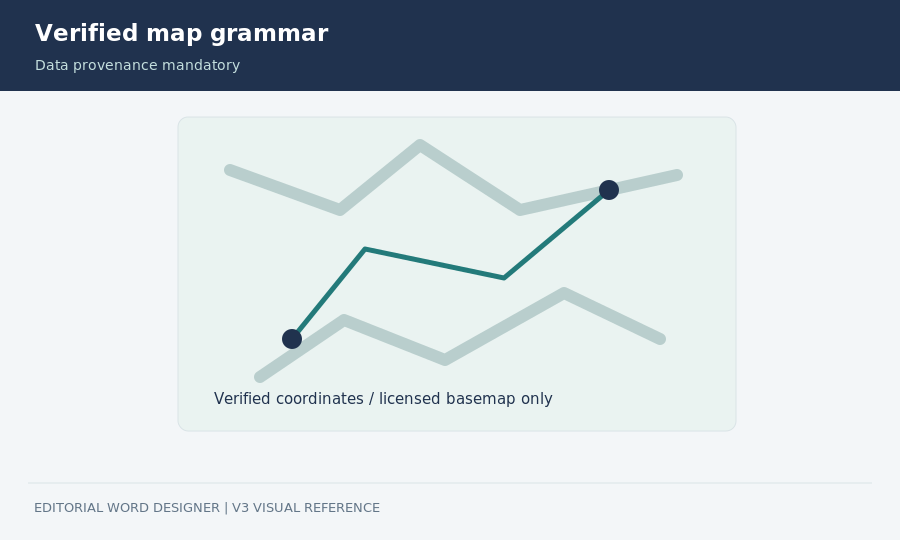

- **Use when:** spatial learning outcome.
- **PASS:** Verified coordinates, geographic source/license and legend.
- **FAIL:** Guessed routes and coordinates.
- **Vector source:** [`13-map.svg`](../assets/visual-examples/13-map.svg)

## 14-callouts: Semantic Callout Family

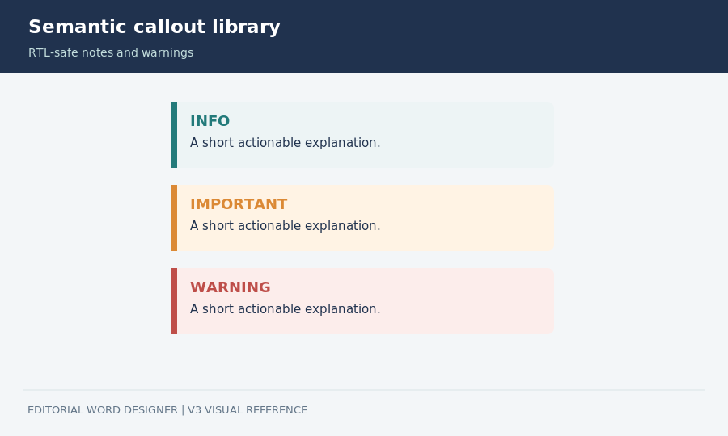

- **Use when:** short caution, example or high-value aside.
- **PASS:** Real editable Word box with side-aware stripe; explanatory heading.
- **FAIL:** Colored box dominating the article without purpose.
- **Vector source:** [`14-callouts.svg`](../assets/visual-examples/14-callouts.svg)

## 15-inline-code: Inline Code Style

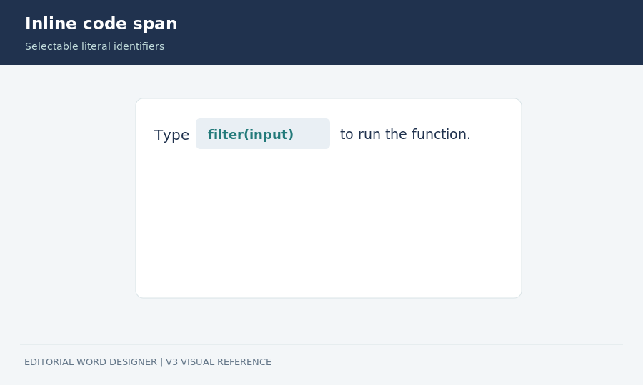

- **Use when:** short literal identifier in prose.
- **PASS:** Selectable monospaced code in correctly isolated LTR run.
- **FAIL:** Code shown as image or broken Arabic bidi.
- **Vector source:** [`15-inline-code.svg`](../assets/visual-examples/15-inline-code.svg)

## 16-code-block: Separate Code Box

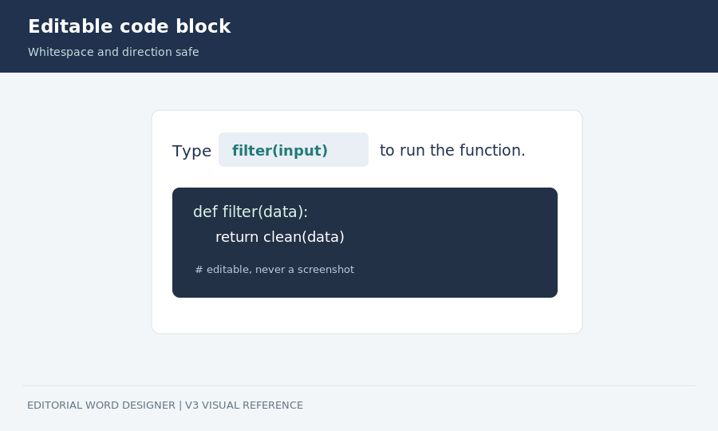

- **Use when:** multiline code or copyable terminal command.
- **PASS:** Native Word code styling; preserve indentation/newlines and wrapping.
- **FAIL:** Rasterized nonselectable code.
- **Vector source:** [`16-code-block.svg`](../assets/visual-examples/16-code-block.svg)

## 17-cross-reference: Bookmarks And Ref Field

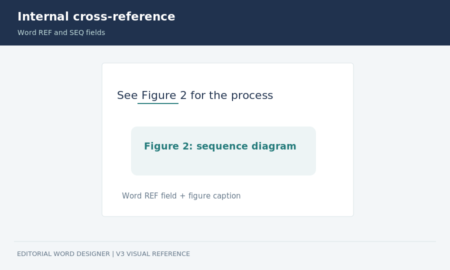

- **Use when:** refer to a caption or section internally.
- **PASS:** Accurate real SEQ/REF field after refreshed and checked.
- **FAIL:** Unverified manually typed cross-reference.
- **Vector source:** [`17-cross-reference.svg`](../assets/visual-examples/17-cross-reference.svg)

## 18-no-visual: No-Visual Rule

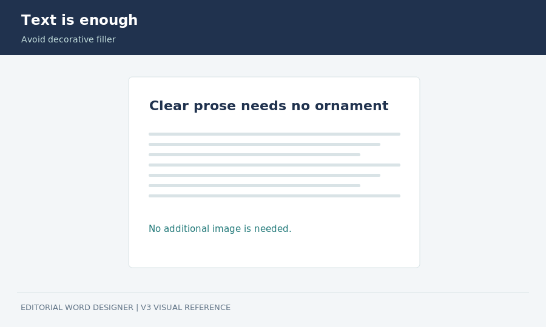

- **Use when:** strong prose already makes idea clear.
- **PASS:** Keep uncluttered text with meaningful spacing.
- **FAIL:** Add arbitrary stock photo to every heading.
- **Vector source:** [`18-no-visual.svg`](../assets/visual-examples/18-no-visual.svg)

## 19-citation: Source Mentions Close To Factual Claims

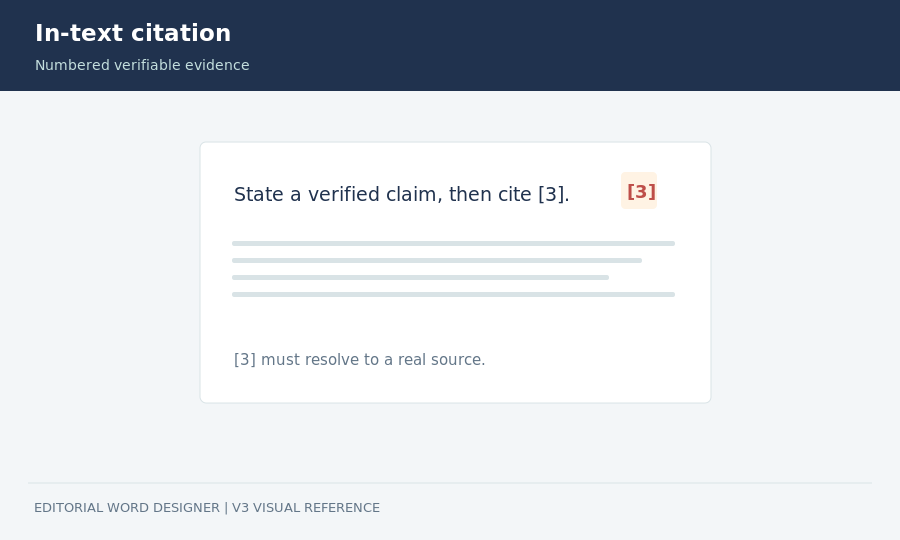

- **Use when:** external facts require traceable support.
- **PASS:** Use the same stable [n] for same verified source.
- **FAIL:** Invented citation or number with no ledger.
- **Vector source:** [`19-citation.svg`](../assets/visual-examples/19-citation.svg)

## 20-bibliography: Final Bibliography

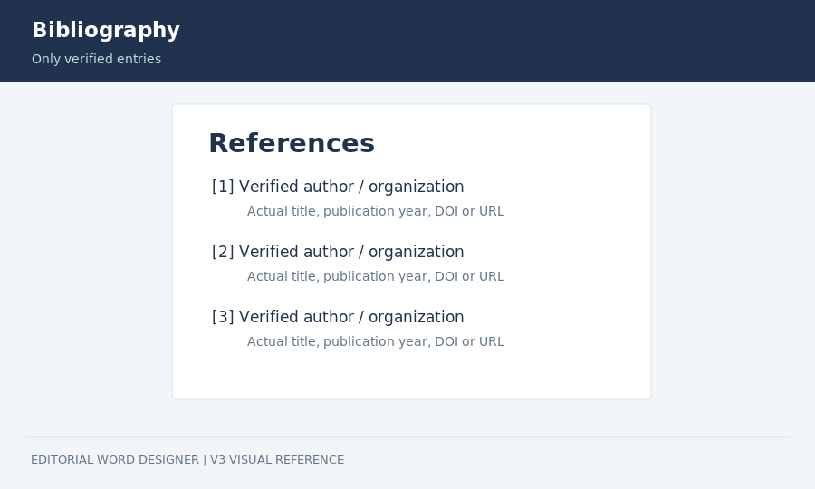

- **Use when:** source-ledger used.
- **PASS:** Every cited source matches complete verifiable reference data.
- **FAIL:** Unconsulted filler references.
- **Vector source:** [`20-bibliography.svg`](../assets/visual-examples/20-bibliography.svg)

## 21-list-of-figures: Figures/Tables Index

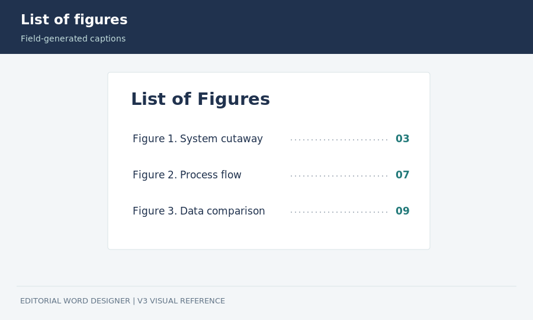

- **Use when:** multi-figure long report.
- **PASS:** Captions with SEQ, list generated from fields and checked after refresh.
- **FAIL:** Hardcoded index described as automatic.
- **Vector source:** [`21-list-of-figures.svg`](../assets/visual-examples/21-list-of-figures.svg)

## 22-accessibility: Accessible Visual Text And Table Semantics

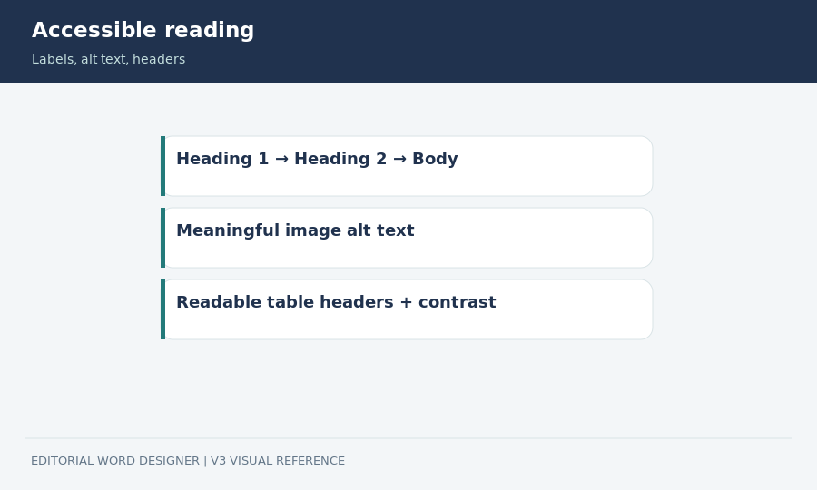

- **Use when:** always for published content.
- **PASS:** Alt text, headings, semantic table header, equivalent complex chart description.
- **FAIL:** Color-only meaning.
- **Vector source:** [`22-accessibility.svg`](../assets/visual-examples/22-accessibility.svg)

## 23-multilingual: Proper Language-Specific Editions

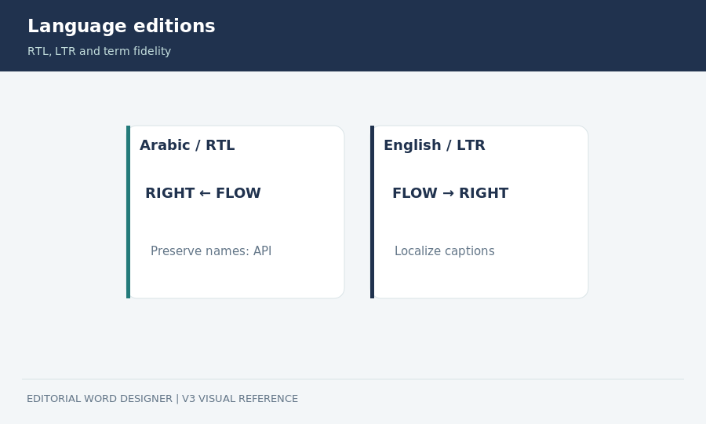

- **Use when:** Arabic, English, Russian or mixed-term text.
- **PASS:** RTL layout per locale, English terms preserved and per-language proofreading.
- **FAIL:** Literal rough translation left unchecked.
- **Vector source:** [`23-multilingual.svg`](../assets/visual-examples/23-multilingual.svg)

## 24-html-companion: Optional Interactive Companion

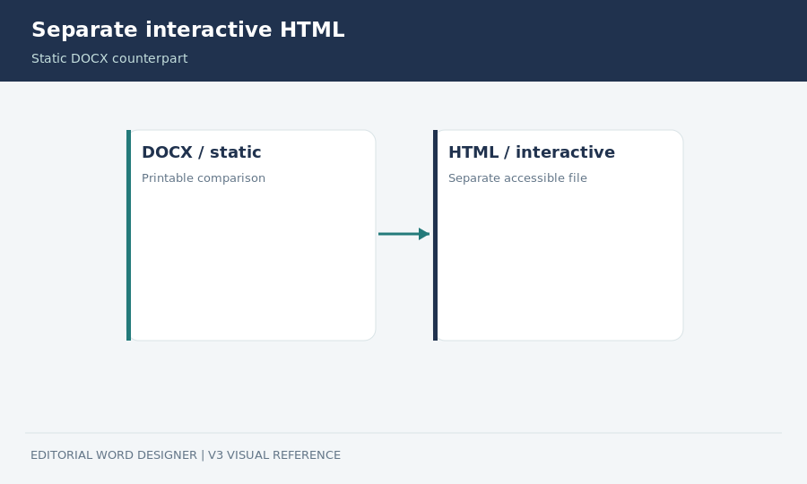

- **Use when:** user wants JS/InfoBank chart functionality.
- **PASS:** Accessible separate HTML + honest static Word counterpart.
- **FAIL:** Claim JavaScript runs in Word.
- **Vector source:** [`24-html-companion.svg`](../assets/visual-examples/24-html-companion.svg)

## 25-review-diff: Edit Review And Change Comparison

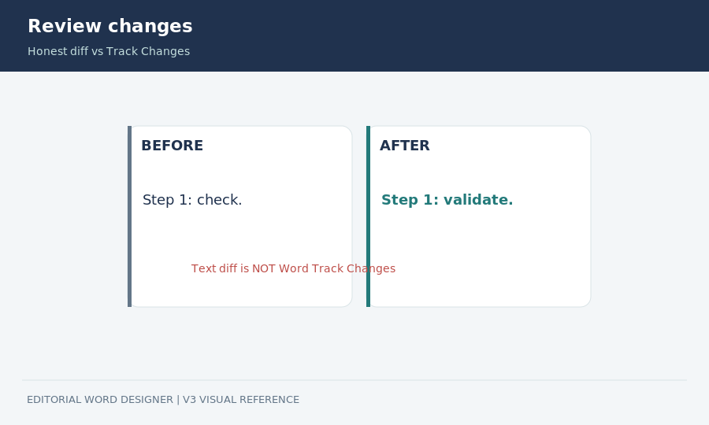

- **Use when:** revising existing files.
- **PASS:** Preserve original; produce clean changes summary; native tracking only with correct tooling.
- **FAIL:** Call a text diff native Track Changes.
- **Vector source:** [`25-review-diff.svg`](../assets/visual-examples/25-review-diff.svg)

## 26-render-qa: Page-By-Page Visual Qa

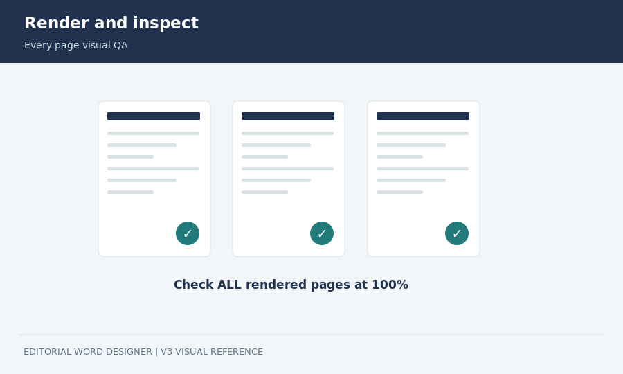

- **Use when:** every final DOCX.
- **PASS:** Render all pages, review actual 100% sizes and repair defects.
- **FAIL:** Declare success based on OOXML alone.
- **Vector source:** [`26-render-qa.svg`](../assets/visual-examples/26-render-qa.svg)

## 27-research-plan: Contract and Search Record

- **Use when:** every substantive research document before searching.
- **PASS:** Question, scope, date, source rules and actual search log are recorded; access limits are explicit.
- **FAIL:** Claim “comprehensive search” without logging where and how the search was done.
- **Worked example:** For a policy brief, record the jurisdiction, law-currentness date and exact official sources searched; distinguish inaccessible text from text not found.

## 28-claim-evidence: Claim–Evidence Matrix

- **Use when:** any material factual claim appears.
- **PASS:** Stable claim ID links to consulted source IDs, locators, limitations and wording.
- **FAIL:** Source appears in bibliography but does not support the sentence.
- **Worked example:** C-014 maps to S004/Table 2; the sentence keeps “associated with” and names the studied population.

## 29-literature-synthesis: Cross-Study Synthesis

- **Use when:** multiple studies answer related questions.
- **PASS:** Group by question/method/population; state agreement, disagreement and gaps.
- **FAIL:** One source-by-source summary with no comparison.
- **Worked example:** Compare two studies’ outcome definitions before describing their different estimates; do not average unlike measures.

## 30-citation-style: Citation Style and Metadata

- **Use when:** the brief or venue requires a citation style.
- **PASS:** Style/version and any journal variant are named; references are matched and metadata exceptions disclosed.
- **FAIL:** Label output “Harvard compliant” without identifying the applicable variant.
- **Worked example:** Record Vancouver plus a journal’s abbreviation rule; leave an unverified DOI unresolved.

## 31-academic-mode: Genre and Front Matter

- **Use when:** research genre determines structure.
- **PASS:** Required sections match the selected mode and governing template.
- **FAIL:** Use an experimental Results section for a review without a template requirement.
- **Worked example:** A systematic review reports databases and screening steps actually completed; planned searches are not reported as completed.

## 32-long-document-index: Chapter Package and Word Index

- **Use when:** work is about 100 pages or explicitly requested in separate chapters.
- **PASS:** Stable chapter names, continuity plan, 00_Index.docx, all files together, and each relative link tested before promising click-to-open behavior.
- **FAIL:** Links claimed to work without testing or an index points to a renamed file.
- **Worked example:** Place 00_Index.docx beside CH01_Introduction.docx and test the chapter-title link after copying the package to its final folder; disclose filename-only fallback if unsupported.
