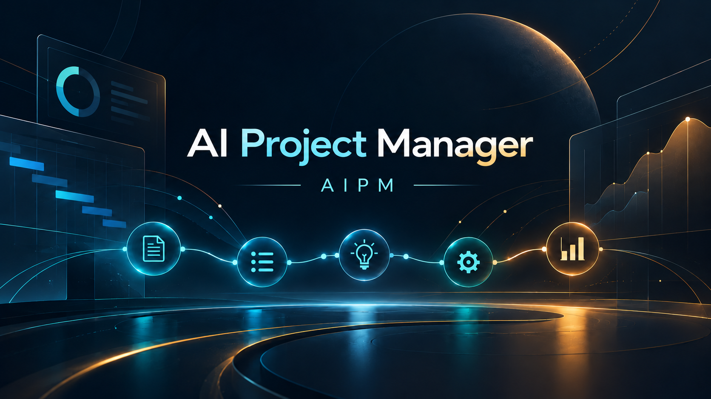

<div align="center">
  

  <h1>AI Project Manager v1.5.8</h1>
  <p><strong>A governed, local-first workspace for AI-assisted project execution.</strong></p>

  <p>
    <a href="https://github.com/Abdulrahman3M/AI-Project-Manager-AIPM/releases/tag/v1.4.0"></a>
    
    <a href="LICENSE"></a>
    
    
    <a href="docs/project/Support-Matrix.md#p09-closure"></a>
  </p>

  <p>
    <a href="#overview">Overview</a> ·
    <a href="#capabilities">Capabilities</a> ·
    <a href="#explore-skills-and-prompts">Skills &amp; Prompts</a> ·
    <a href="#quick-start">Quick Start</a> ·
    <a href="#security-and-privacy">Security</a> ·
    <a href="#project-status">Project Status</a>
  </p>
</div>

---

## Overview

AI Project Manager (AIPM) is a local-first project-management platform built to help people and AI agents work from clear task context and verifiable evidence. Its Core Engine manages registration, task records, supporting artifacts, progress, and handoffs; the PowerShell Intelligent TUI provides evidence-based views and guarded registry administration.

**Core principle:** AIPM manages task context, artifacts, progress, and handoffs—not the target project's implementation files or execution permissions. Agents edit the original project files and run project tests through their own host tools. AIPM keeps supporting task material under that project's `Shared-Project-State-Manager/`; it does not duplicate working source files, run target-project tests, or impose an AIPM approval gate on source edits. The TUI can create and update AIPM-owned task records; its task folder option references existing files without moving or copying them. The implementation stays in the original project files.

AIPM is designed to make project context explicit and portable while keeping authority with the project owner. A compatible package does not grant an agent access to local files or start an AI session on its own.

## Capabilities

| Area | What It Provides |
| --- | --- |
| **Core Engine** | Project registration, validated state, task lifecycle, evidence records, and continuity operations. |
| **Capability Library** | A governed catalog of Skills and Prompts with version, provenance, and integrity metadata. |
| **Multi-Host Plugin Distribution** | Build verified ChatGPT/Codex, Claude Code, and Google Antigravity capability packages from governed Skills and Prompts. |
| **Legacy Agent Bridge** | A separately versioned compatibility package that explains how an AI agent should use AIPM Core and approved Skills. |
| **Host Adapters** | Declared host capabilities, explicit permission gates, and fail-closed behavior for unsupported operations. |
| **Intelligent TUI** | Project dashboards, task and evidence views, capability catalog, guarded registry setup/connection/backup/restore, keyboard navigation, and accessible terminal styling. |

## Explore Skills And Prompts

| [**Explore General Skills →**](docs/guides/General-Skills.md) | [**Explore General Prompts →**](docs/guides/General-Prompts.md) |
| --- | --- |
| Browse all 12 General Skills to learn what they do, when to use them, and where to read their full instructions. | Browse the standalone General Prompt index for a concise guide to each prompt and a link to its complete text. |

## Quick Start

New To AIPM? Follow The [English Beginner Guide](docs/guides/Beginner-Guide.en.md) Or [دليل المبتدئين بالعربية](docs/guides/دليل-المبتدئين.ar.md) For A Step-By-Step Walkthrough.

### Requirements

- Windows PowerShell 5.1 or PowerShell 7.x
- Python 3.10 or later available on `PATH`
- A real interactive terminal for keyboard navigation

### Launch the terminal interface

On Windows, run:

```powershell
TUI\AI-Project-Manager\AIPM.bat
```

Or launch PowerShell directly:

```powershell
pwsh -NoProfile -File TUI\AI-Project-Manager\Start-AIPM.ps1
```

For command-line options and view-mode guidance, see the [TUI User Guide](TUI/AI-Project-Manager/README.md).

## How AIPM Works

```text
Project Owner
     │ defines scope and permissions
     ▼
AI Agent ───────► Host Adapter ───────► AIPM Core Engine
     ▲                                      │
     │ approved Skills and handoff          │ project state and evidence
     └──────────────────────────────────────┘
                                            ▼
                             Project Views + Registry Management
```

The Core Engine is the authority for registered project and task state. Host adapters expose only declared operations and require explicit permission for writes. The TUI reads Core-backed evidence and performs only explicit, validated registry actions; it can initialize AIPM-owned state in a project after owner confirmation, but does not edit project source files. Values without supporting evidence remain unknown or unverified.

## Security and Privacy

- Project state remains within the project and AIPM Core storage boundaries.
- The registry stores project IDs, aliases, and root paths only. It defaults to `%LOCALAPPDATA%\AI-Project-Manager\registry.json` on Windows, outside the repository; first launch asks the owner to approve this path or choose another full file path ending in `.json` outside AIPM. The file name may be chosen freely.
- A project's operational state stays inside that project's `Shared-Project-State-Manager/` folder. Unregistering removes only its registry pointer; restoring a registry makes a pre-restore safety copy.
- Core-managed project roots, registry files, and backups cannot overlap the AIPM installation. This Core guard and `AGENTS.md` do not replace host/OS permissions: an external agent with direct filesystem writes must be separately sandboxed from AIPM.
- Host operations are capability-declared, permission-gated, and fail-closed.
- Manual handoff text is treated as unverified input until a receiving session re-reads authoritative state.
- The local Agent Bridge does not install itself, start a background agent, or grant automatic file access.
- Capability metadata records Skill versions, provenance, and integrity information.

Read the [Host Adapter Contract](Plugins/Adapters/Host-Adapter-Contract.md) and [Project Rules](docs/project/Project-Rules.md) for operational details.

## Project Status

AIPM includes a Python Core Engine, an owner-managed Skill and Prompt library, a generated local Agent Bridge, host capability declarations, and a PowerShell terminal interface. Automated regression suites cover the Core, capability library, and TUI.

The current AIPM repository and PowerShell TUI development version is `1.5.8`; the latest published GitHub Release remains `v1.4.0`. See the [v1.5.8 repository update notes](docs/project/Release-Notes/Release-Notes-v1.5.8.md), [P00–P10 completion record](docs/project/Project-Completion-Record-v1.4.8.md), and [completion archive](AIPM-Project-Completion-Archive-v1.4.8.zip). All project phases are closed by owner acceptance; P09 includes owner-confirmed real-project and cross-agent use. Optional host Plugin installation and native Antigravity runtime acceptance remain separate, unverified capabilities.

See the [Support Matrix](docs/project/Support-Matrix.md) for verified environments and outstanding host gates, and the [AIPM Architecture And Plugin Distribution](docs/project/Architecture/Plugin-Distribution-Architecture.md) for the current structure and package workflow.

## Repository Map

| Path | Purpose |
| --- | --- |
| `Core-Engine/` | Core runtime, state, orchestration, adapters, and capability logic. |
| `01-Skills-General/` | Owner-managed General Skills. |
| `02-Prompt-General/` | Standalone reusable Prompts. |
| `Capability-Library/` | Machine-readable registry and first-party capability declarations. |
| `Plugins/Adapters/` | Host capability matrix, adapter contract, and schema. |
| `Plugins/Build-System/` | Multi-host package builder, validators, and target profiles. |
| `Plugins/aipm-project-agent-bridge/` | Generated legacy compatibility package and bundled Skills. |
| `Plugins/Dist/` | Locally generated host-specific Plugin archives and checksums. |
| `TUI/AI-Project-Manager/` | PowerShell terminal application, launchers, documentation, and tests. |
| `UX-TUI/` | Interface design system, visual references, and project brand assets. |
| `Tests/` | Python integration and regression suites. |
| `docs/guides/` | Beginner guides in English and Arabic. |
| `docs/project/` | Current architecture, rules, support, provenance, and versioned release notes. |

## Validation

Run the PowerShell terminal application tests:

```powershell
pwsh -NoProfile -File TUI\AI-Project-Manager\tests\Run-Tests.ps1
```

Run the Core and integration tests:

```powershell
python -m unittest discover -s Tests -v
```

Validate the capability catalog and local Agent Bridge:

```powershell
python Maintenance-Tools\Invoke-Capability-Library.py validate
python Maintenance-Tools\Invoke-Capability-Library.py validate-plugin --output Plugins\aipm-project-agent-bridge
```

## Documentation

- [Project Index](Index.md)
- [Beginner Guides — English And Arabic](docs/guides/README.md)
- [Capability Library](Capability-Library/README.md)
- [General Skills](docs/guides/General-Skills.md)
- [General Prompts](docs/guides/General-Prompts.md)
- [Host Capability Matrix](Plugins/Adapters/Host-Capability-Matrix.json)
- [Intelligent TUI Design System](UX-TUI/README.md)
- [TUI User Guide](TUI/AI-Project-Manager/README.md)
- [Support Matrix](docs/project/Support-Matrix.md)
- [Latest Repository Update Notes](docs/project/Release-Notes/Release-Notes-v1.5.8.md)
- [Latest Published Release Notes](docs/project/Release-Notes-v1.4.0.md)

## License

The project is distributed under the [Apache License 2.0](LICENSE). Copyright 2026 Abdulrahman Elbatrah. See [NOTICE](NOTICE) for attribution information.
