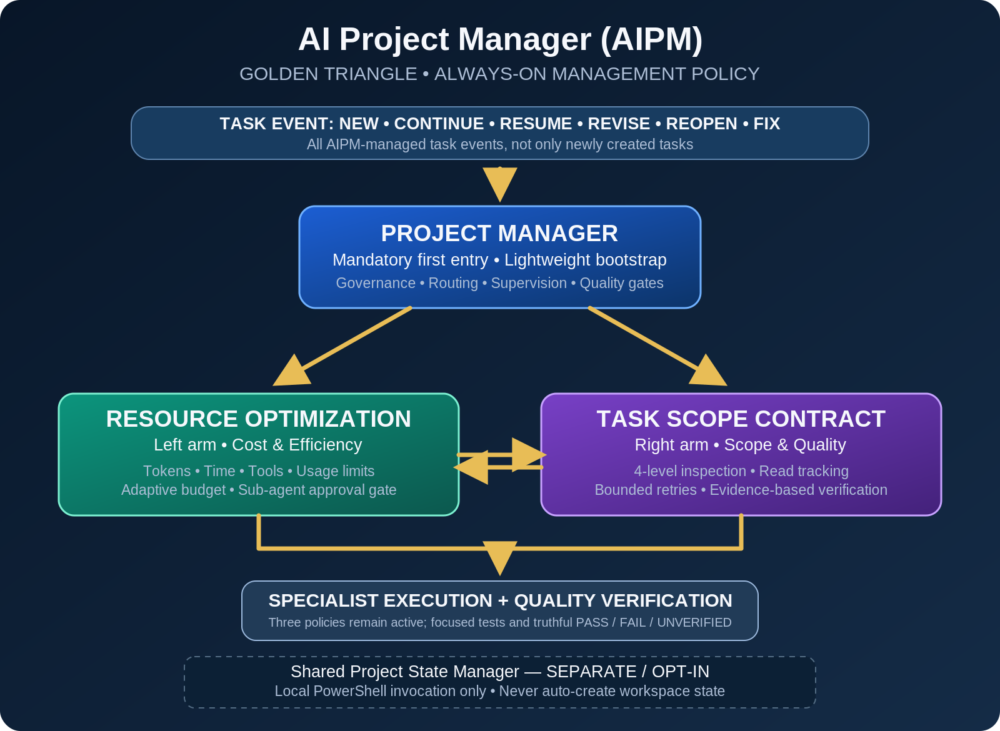

# Golden Triangle Operating Model

AI Project Manager (AIPM) is the product. Project Manager is its task-management Skill and the intended first entry for every AIPM-managed interaction: new, active, resumed, revised, reopened, corrective and recheck work. It performs a lightweight bootstrap, preserves task identity and prior evidence, and coordinates specialists and quality acceptance.

[Open the accessible vector diagram](assets/AIPM-Golden-Triangle.svg). The description below conveys the diagram's structure without relying on color or arrows.

- **Project Manager:** owns governance, routing, lifecycle reconciliation, supervision and final evidence-based acceptance.
- **Resource Optimization, left:** owns token, time, tool and usage-limit efficiency, adaptive budgets and explicit owner approval for eligible delegation. Required quality checks always take precedence.
- **Task Scope Contract, right:** owns read and edit scope, evidence-led discovery, read tracking, bounded retries and the quality contract.

Both subordinate policies remain active throughout specialist execution. Work uses one agent by default; small tasks never spawn one, and large-task delegation requires explicit owner approval. Missing telemetry is `NOT_MEASURED`; failed or unverified required checks cannot be reported as complete.

Shared Project State Manager is separate from the triangle: it is an optional local PowerShell tool invoked only at the owner's explicit request. This does not disable the independently permission-gated AIPM Core registry or task-state operations.

The diagram describes the desired operating policy, not proof of a host interception mechanism. A Skill or package instruction alone is **instruction only**; actual enforcement and host access must be tested and reported separately. See the [Host Adapter Contract](../../../Plugins/Adapters/Host-Adapter-Contract.md).
